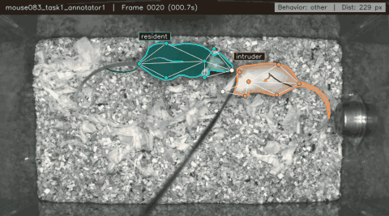
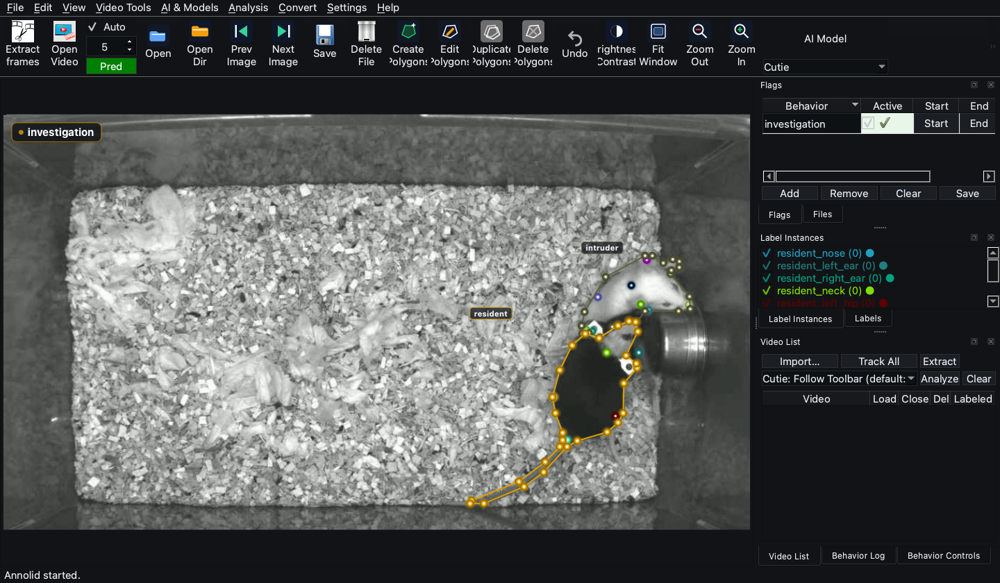
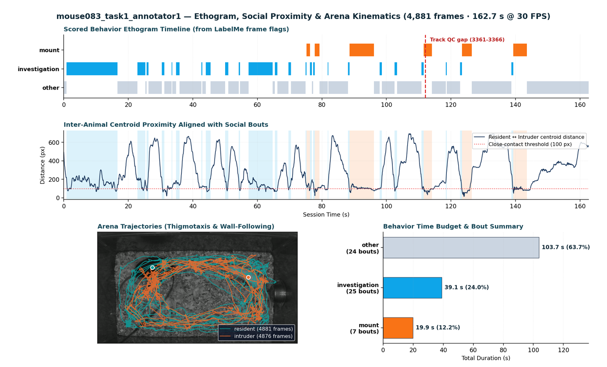
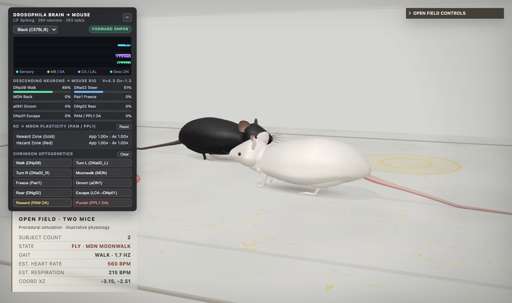

<section class="ann-hero">
  Annolid Documentation Portal
  <h1>Run reproducible annotation, tracking, and 3D simulation workflows.</h1>
  

    Annolid combines a desktop GUI, a composable CLI (<code>annolid-run</code>),
    offline Three.js 3D simulations, and optional agent-assisted tools for
    end-to-end animal behavior analysis.
  

  

    Start with a stable local setup, follow the real <code>mouse083_task1_annotator1</code>
    resident-intruder walkthrough, then move into repeatable training, Track QC,
    zone analysis, ethogram reporting, and automation.
  

  

    <a href="tutorials/mouse083_resident_intruder_showcase/">Featured Walkthrough: mouse083 Resident-Intruder</a>
    <a href="assets/reports/mouse083_report.html" target="_blank" rel="noopener">Open Live HTML5/SVG Example Report</a>
    <a href="getting_started/">Getting Started in 20 minutes</a>
    <a href="installation/">Install Annolid</a>
    <a href="workflows/">Follow core workflows</a>
    <a href="reporting_and_statistics/">Analysis &amp; Reporting Studio</a>
    <a href="two_mice_simulation/">Two-Mouse &amp; Fly-Brain 3D Simulation</a>
    <a href="simulation_flybody/">FlyBody 3D Simulation</a>
    <a href="sam3/">Track long videos with SAM3</a>
    <a href="tutorials/">Explore all tutorials</a>
  

</section>

## Visual Feature Tour

  <article class="ann-showcase-card">
    
    

      <h3>Multi-Animal Tracking &amp; 14 Keypoints</h3>
      
Track instance polygons, anatomical landmarks, and live social states across 4,881 frames of real home-cage video.

      <a href="tutorials/mouse083_resident_intruder_showcase/">Open full mouse083 walkthrough →</a>
    

  </article>
  <article class="ann-showcase-card">
    
    

      <h3>Desktop Annotation &amp; Behavior Workspace</h3>
      
Label polygons, keypoints, zones, and BORIS-compatible ethogram events in one interactive Qt desktop application.

      <a href="getting_started/">Start a 20-minute GUI session →</a>
    

  </article>
  <article class="ann-showcase-card">
    
    

      <h3>Ethograms, Kinematics, Zones &amp; HTML5 Reports</h3>
      
Export Track QC review queues, zone occupancy, freezing, IRR, and self-contained HTML5/SVG reports with one command.

      <a href="reporting_and_statistics/">Explore Reporting &amp; Analysis Studio →</a>
    

  </article>
  <article class="ann-showcase-card">
    
    

      <h3>Offline 3D Simulations &amp; Connectome NeuroAI</h3>
      
Benchmark pose/body-part trackers with Two-Mouse 3D digital twins, Fly-Brain LIF spiking circuits, and FlyBody rollouts.

      <a href="two_mice_simulation/">Explore 3D Simulation docs →</a>
    

  </article>

## Choose Your Path

  <article class="ann-path">
    <strong>New Users</strong>
    Install Annolid, open a sample recording, and inspect the complete <code>mouse083</code> walkthrough.
     
    <a href="installation/">Installation</a> |
    <a href="getting_started/">Getting Started</a> |
    <a href="tutorials/mouse083_resident_intruder_showcase/">mouse083 Demo</a>
  </article>
  <article class="ann-path">
    <strong>Power Users</strong>
    Automate Track QC, kinematics, zone exports, pose interop, and agent runs with <code>annolid-run</code> and MCP.
     
    <a href="workflows/">Workflows</a> |
    <a href="reporting_and_statistics/">Reporting</a> |
    <a href="agent_annolid_run/">Agent CLI</a> |
    <a href="reference/">Reference</a>
  </article>
  <article class="ann-path">
    <strong>Maintainers</strong>
    Preview website + docs together locally, run strict checks, and regenerate showcase visuals reproducibly.
     
    <a href="deployment/">Docs &amp; Site Workflow</a> |
    <a href="migration/">Migration Plan</a>
  </article>

## Core Areas

  <article class="ann-card">
    <h3>Setup</h3>
    
Pick the right environment path for your platform and development mode.

    <a href="installation/">Open installation guide</a>
  </article>
  <article class="ann-card">
    <h3>Workflow Execution</h3>
    
Run GUI and CLI tasks with explicit command patterns that can be repeated.

    <a href="workflows/">Open workflows</a>
  </article>
  <article class="ann-card">
    <h3>Zone Analysis</h3>
    
Draw chamber layouts, reuse zone files, and export phase-aware summaries.

    <a href="zone_analysis/">Open zone analysis reference</a>
  </article>
  <article class="ann-card">
    <h3>Reporting &amp; Statistics</h3>
    
Generate self-contained HTML5/SVG reports, Track QC queues, IRR, and cohort statistics.

    <a href="reporting_and_statistics/">Open reporting guide</a>
  </article>
  <article class="ann-card">
    <h3>3D Simulations</h3>
    
Run offline Two-Mouse Three.js, Fly-Brain LIF connectome, and FlyBody 3D workflows.

    <a href="two_mice_simulation/">Open 3D simulation guide</a>
  </article>
  <article class="ann-card">
    <h3>SAM3 &amp; Sparse Keypoints</h3>
    
Track long or occluded videos with SAM3, DINOv3 keypoints, TAPNext, or CoWTracker.

    <a href="dinov3_keypoint_tracking/">Open keypoint tracking guide</a>
  </article>
  <article class="ann-card">
    <h3>Agent CLI &amp; Bot</h3>
    
Use Annolid Bot and typed <code>annolid_run</code> / MCP tools for assisted analysis.

    <a href="agent_annolid_run/">Open agent CLI guide</a>
  </article>
  <article class="ann-card">
    <h3>Memory &amp; Security</h3>
    
Store reusable context, isolate secrets, and validate local agent security posture.

    <a href="agent_security/">Open security docs</a>
  </article>
  <article class="ann-card">
    <h3>Docs &amp; Site Operations</h3>
    
Preview landing page + portal locally, run <code>make site-check</code>, and publish cleanly.

    <a href="deployment/">Open deployment guide</a>
  </article>

## Product Snapshot

- Python package metadata supports `>=3.10`; the default GUI/core workflow is documented for Python 3.10–3.15.
- Primary entry points are `annolid` (desktop GUI) and `annolid-run` (composable CLI, Track QC, kinematics, zone analysis, and HTML5/SVG reporting).
- Bundled offline Three.js viewers power Two-Mouse 3D open-field simulation, Fly-Brain LIF connectome control, and FlyBody 3D playback.
- Annolid Bot supports multimodal chat, typed `annolid-run` execution, and optional MCP/provider integrations inside the GUI.
- Both `website/` and `docs/` share a unified local preview, watch, and strict validation workflow (`make site-watch`, `make site-check`).
