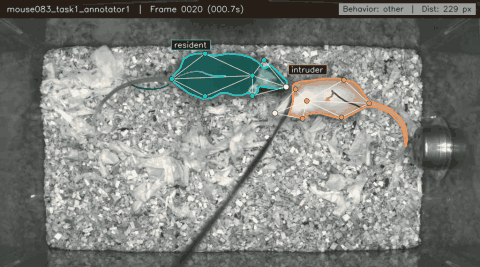
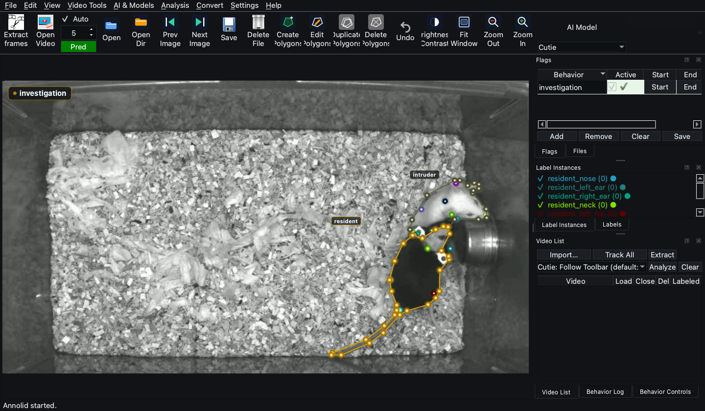
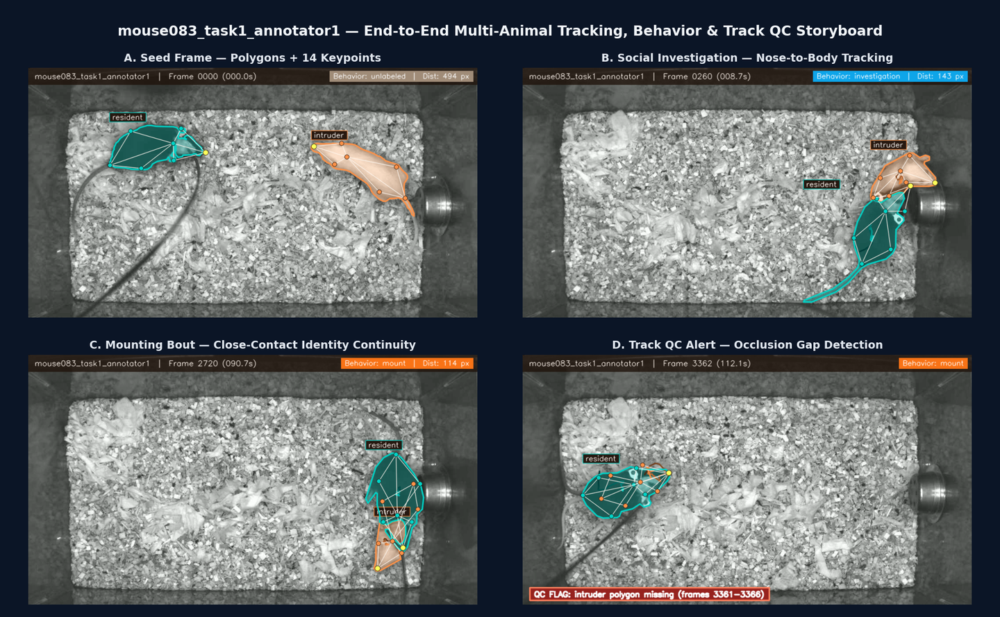
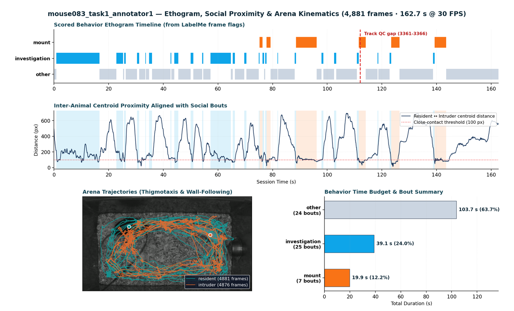
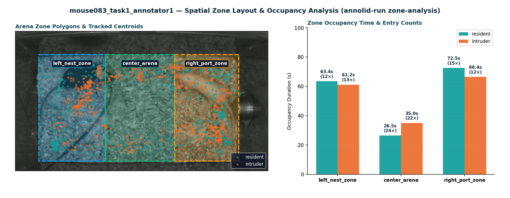
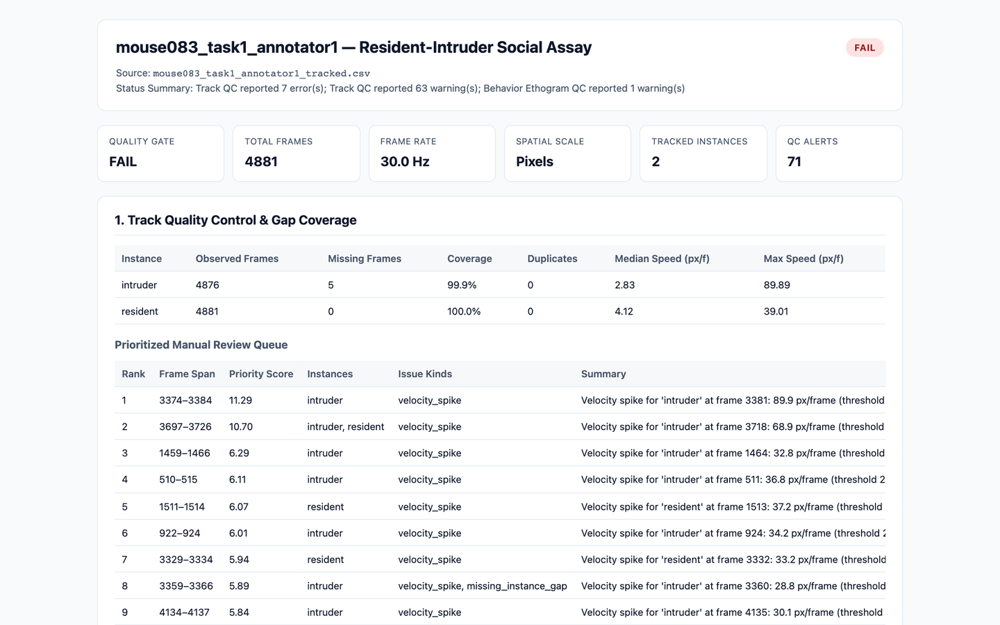
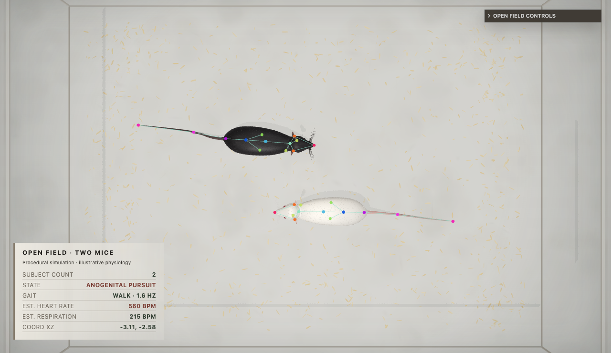
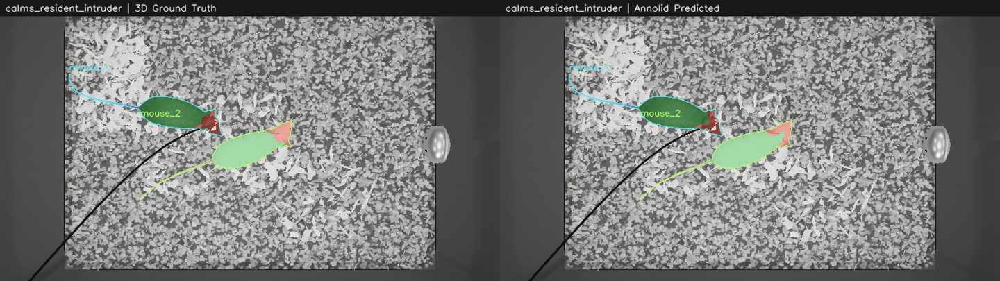

# End-to-End Walkthrough: Resident-Intruder Social Assay (`mouse083_task1_annotator1`)

This worked example walks through a complete Annolid analysis pipeline on a real two-mouse resident-intruder home-cage recording (`mouse083_task1_annotator1.mp4`: `1024 × 570`, `30 FPS`, `4,881 frames`, `162.7 s`).

Using one real session, you can see how Annolid connects:

1. desktop GUI labeling of instance polygons, 14 anatomical keypoints, and behavior flags,
2. multi-animal tracking across challenging close-contact social interactions and tether occlusions,
3. automated Track QC and occlusion-gap detection for targeted human-in-the-loop repair,
4. spatial zone occupancy and place-preference scoring,
5. ethogram time budgets, body-part contact analysis, and self-contained HTML5/SVG reporting, and
6. Annolid's matching 3D Two-Mouse and Fly-Brain simulations for synthetic benchmarking.

<div class="ann-metrics-strip">
  <div class="ann-stat">
    <strong>4,881 frames</strong>
    <span>162.7 s @ 30 FPS (1024 × 570)</span>
  </div>
  <div class="ann-stat">
    <strong>2 masks + 14 keypoints</strong>
    <span>resident &amp; intruder, 7 landmarks each</span>
  </div>
  <div class="ann-stat">
    <strong>39.1 s / 19.9 s</strong>
    <span>investigation (25 bouts) · mount (7 bouts)</span>
  </div>
  <div class="ann-stat">
    <strong>5-frame QC alert</strong>
    <span>intruder occlusion flagged at 3361–3366</span>
  </div>
</div>

<div class="ann-cta-bar">
  <a class="ann-btn ann-btn--primary" href="../../assets/reports/mouse083_report.html" target="_blank" rel="noopener">Open Live Interactive HTML5/SVG Report</a>
  <a class="ann-btn" href="../../reporting_and_statistics/">Reporting &amp; Analysis Studio Docs</a>
  <a class="ann-btn" href="../../two_mice_simulation/">Two-Mouse 3D Simulation</a>
</div>

## Animated Tracking & Behavior Preview



In this 30 FPS home-cage assay, a tethered black resident mouse (`resident`, cyan contour + 7 keypoints) interacts with a white intruder mouse (`intruder`, coral contour + 7 keypoints) on textured aspen bedding near a right-wall feeder port.

## 1. Project Files & Data Contract

Annolid keeps every stage reviewable on disk with plain JSON and CSV contracts:

```text
mouse083_task1_annotator1.mp4                  # Source 30 FPS video (1024 × 570, 4,881 frames)
mouse083_task1_annotator1/
  project.annolid.json                         # Canonical ethogram schema (other, investigation, mount)
  mouse083_task1_annotator1_000000000.json     # Per-frame LabelMe JSON (2 polygons + 14 keypoints + flags)
  ...
  mouse083_task1_annotator1_000004880.json
mouse083_task1_annotator1_tracking.csv         # 78,091 rows: RLE masks, bboxes, centroids for all 16 shapes
mouse083_task1_annotator1_tracked.csv          # 9,757 rows: per-animal centroids, motion index, timestamps
```

Each frame JSON contains:

- **2 whole-animal polygons**: `resident` and `intruder`
- **14 anatomical keypoints** (7 per mouse, grouped by `group_id` `0` and `1`):
  `nose`, `left_ear`, `right_ear`, `neck`, `left_hip`, `right_hip`, `tail_base`
- **Frame-level ethogram flags**: `other`, `investigation`, or `mount`

## 2. Labeling & Review in the Desktop GUI



Inside `annolid`, the video canvas renders polygons, keypoints, instance badges, and viewport-pinned behavior overlay pills (`• investigation`), while the right-hand docks synchronize **Flags**, **Label Instances**, **Video List**, **Behavior Log**, and **Behavior Controls**.

To run a similar session from scratch:

1. Open the video directly in the GUI (`File → Open Video`) — frame extraction is optional.
2. Label a clean seed frame (`Frame 0000`) with instance polygons and optional body-part keypoints.
3. Track polygons across the recording using **Cutie**, **SAM3**, or **YOLO**, and propagate sparse keypoints with [DINOv3 Keypoint Tracking](../dinov3_keypoint_tracking.md).
4. Score behavior states (`investigation`, `mount`, `other`) using **Flags**, the **Timeline** playhead, **Live Keyboard Coding**, or **Annolid Bot**.

## 3. Multi-Animal Tracking Across Social States & Track QC

Real social-behavior recordings include both clean exploration and difficult high-overlap contact where a mouse temporarily occludes its partner.



- **Panel A (Frame 0000 · Seed Frame)**: Both mice are clearly separated (`494 px` apart), ideal for initializing masks and 14 keypoints.
- **Panel B (Frame 0260 · `investigation`)**: Close nose-to-body sniffing near the right port (`143 px` centroid distance) with clean identity separation.
- **Panel C (Frame 2720 · `mount`)**: High-overlap dyadic contact where instance polygons and skeletons remain disambiguated.
- **Panel D (Frame 3362 · Track QC Occlusion Alert)**: During a close mounting bout (`frames 3346–3422`), the black resident directly occludes the white intruder, causing a **5-frame `intruder` polygon dropout** (`frames 3361–3364, 3366`).

Rather than silently averaging over tracking errors, run `annolid-run track-qc` to rank the highest-risk frames for targeted review:

```bash
annolid-run track-qc mouse083_task1_annotator1_tracked.csv \
  --expected-instances 2 \
  --fps 30 \
  --review-csv mouse083_review_queue.csv \
  --out mouse083_track_qc.json
```

Double-clicking any row in **Analysis → Analysis & Reporting Studio → Track QC & Gaps** jumps the main canvas straight to frame `3361` so you can repair the single occluded frame and re-propagate cleanly with Cutie or SAM3.

## 4. Ethogram Timeline, Social Proximity & Arena Kinematics



Running Annolid's kinematics, body-part ethogram, and time-budget analytics on `mouse083_task1_annotator1` produces:

| Metric | `resident` | `intruder` |
| --- | --- | --- |
| Observed Frames (Coverage) | 4,881 / 4,881 (`100.0%`) | 4,876 / 4,881 (`99.9%`) |
| Path Distance | `27,173.4 px` | `20,957.8 px` |
| Mean Speed | `167.06 px/s` | `128.78 px/s` |
| Freezing % (Bouts) | `3.5%` (`7` bouts) | `4.0%` (`9` bouts) |
| Inter-Animal Distance | Mean `280.5 px` · Min `15.7 px` | Close contact (`< 100 px`): `5.7%` |

Scored behavior time budget across the `162.7 s` trial:

| Behavior | Bouts | Total Duration | Mean Bout | Median Bout | % of Session |
| --- | --- | --- | --- | --- | --- |
| `other` | 24 | `103.70 s` | `4.32 s` | `3.65 s` | `63.7%` |
| `investigation` | 25 | `39.07 s` | `1.56 s` | `0.63 s` | `24.0%` |
| `mount` | 7 | `19.90 s` | `2.84 s` | `2.57 s` | `12.2%` |

Notice how sharp drops in the resident-to-intruder centroid distance curve align directly with shaded `investigation` (blue) and `mount` (orange) bouts, while the full-session trajectory overlay clearly reveals wall-following thigmotaxis around the home-cage perimeter.

## 5. Spatial Zone & Place-Preference Analysis

Define reusable arena zones in **Video Tools → Zones** (saved as a LabelMe-compatible `*_zones.json` with explicit `semantic_type=zone` metadata) and score occupancy from either the GUI or CLI:

```bash
annolid-run zone-analysis mouse083_task1_annotator1_tracked.csv \
  --zone-file mouse083_zones.json \
  --fps 30 \
  --mode zone_metrics \
  --output-dir ./mouse083_zone_out
```



Computed occupancy across three equal-height cage zones (`left_nest_zone`, `center_arena`, `right_port_zone`):

| Instance | Zone | Occupancy % | Entries | Time in Zone | First Entry Latency | Mean Visit |
| --- | --- | --- | --- | --- | --- | --- |
| `resident` | `left_nest_zone` | `39.0%` | 12 | `63.43 s` | `0.00 s` | `5.29 s` |
| `resident` | `center_arena` | `16.3%` | 24 | `26.47 s` | `0.30 s` | `1.10 s` |
| `resident` | `right_port_zone` | `44.6%` | 15 | `72.53 s` | `1.07 s` | `4.84 s` |
| `intruder` | `left_nest_zone` | `37.6%` | 13 | `61.17 s` | `4.00 s` | `4.71 s` |
| `intruder` | `center_arena` | `21.5%` | 22 | `34.97 s` | `2.27 s` | `1.59 s` |
| `intruder` | `right_port_zone` | `40.9%` | 12 | `66.40 s` | `0.00 s` | `5.53 s` |

Both animals spend over `78%` of the session in the two end zones (`left_nest_zone` and `right_port_zone`), passing rapidly through `center_arena` (`mean visit 1.10–1.59 s`) during perimeter circuits and social approaches.

## 6. One-Command Unified HTML5 + SVG Report

Generate a self-contained scientific report combining Track QC, Kinematics, Zone Analysis, Body-Part Ethogram (`54` anatomical contact bouts), and Behavior Time Budget in one command:

```bash
annolid-run report mouse083_task1_annotator1_tracked.csv \
  --events-csv mouse083_events.csv \
  --zone-file mouse083_zones.json \
  --schema mouse083_task1_annotator1/project.annolid.json \
  --fps 30 \
  --title "mouse083_task1_annotator1 — Resident-Intruder Social Assay" \
  --output-dir ./mouse083_report
```



Open the actual generated HTML5 report right in your browser:
[mouse083_report.html (live interactive report)](../assets/reports/mouse083_report.html){ target="_blank" rel="noopener" }.

## 7. Pairing Real Assays with 3D Simulation Twins

Need ground-truth pose, body-part masks, or controlled occlusion scenarios before running a large cohort? Annolid ships an offline **Two-Mouse 3D Three.js Simulation** (`View → 3D Examples → Two Mice`) modeled on the same black C57BL/6 + white BALB/c paradigm, plus **Fly-Brain LIF Connectome Mode** and **Instance Body Part Segmentation** evaluation benchmarks.

### Two-Mouse 3D Pose & Benchmark Twin



Generate seeded 13-keypoint COCO datasets and occlusion stress tests offline in Three.js. See the [Two-Mouse 3D Simulation Guide](../two_mice_simulation.md).

### Hierarchical Body-Part Segmentation



Decompose tracked whole-animal polygons into non-overlapping `head`, `torso`, and `tail` masks with zero cross-animal bleed. See the [Instance Body Part Segmentation Guide](../body_part_segmentation.md).

## Regenerating This Showcase on Your Own Video

You can regenerate these figures, animated tracking GIF, and sanitized HTML5 report for any Annolid-tracked session with one command:

```bash
make showcase-video VIDEO=/path/to/your_tracked_video.mp4
```

See [Deployment & Docs Workflow](../deployment.md) for local live-preview and validation commands.
