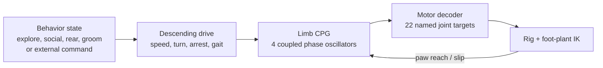

# Two-mouse Three.js simulation

Open **Three.js Examples → Two Mice** in the GUI, or ask Annolid Bot:

```text
open threejs example two mice
```

The scene starts with a black C57BL/6 mouse and a snow-ivory BALB/c mouse on a
matte anti-glare arena floor with curled aspen wood shavings. Models include
multi-layer clumped fur with anisotropic guard-hair sheen, a sleek tapered skull
with split upper-lip cushions, recessed oral cleft, curved ivory incisors, and
tucked lower lip/chin, strain-calibrated rhinarium and almond palpebral rims,
unified cupped vascularized ear pinnae, a monotonically tapered cervical bridge, crouched furred limbs with grounded articulated paws,
mystacial and supraorbital vibrissae, and a countershaded annular-ringed tail.
Exploration includes wall following, active rhythmic whisking, pauses to sniff,
social investigation, rearing, and grooming. This is a procedural visualization,
not a validated animal biomechanics model. Heart rate and respiration in the HUD
are illustrative estimates.

## Viewing and playback

Drag to orbit, scroll to zoom, and use **Simulation Controls → Camera** for an
overview, a view from above, or a camera that follows either strain. The follow
camera preserves your orbit angle while moving with the subject.

- **Pause Simulation** freezes motion and contact solving. The camera and pose-skeleton
  overlay remain usable while paused.
- **Playback Speed** supports slow motion down to 0.25×, up to 1.5×.
- **Quality Mode** changes pixel resolution and shadow resolution without changing
  exposure. **Post-Processing** applies ACES tone mapping and sRGB output encoding
  around the active orbit target so optional vignette, subtle macro depth-of-field,
  and film grain preserve scene brightness.
- **Fur Detail** controls coat density for newly spawned subjects. Reduce it before
  spawning more mice on machines with limited graphics memory.
- **Clear All** releases subject-specific GPU resources. **Spawn Subject** uses the
  selected strain and biological traits.

Appearance toggles that recompile material shaders or rebuild fur coats and limb
chains retain the respawn notice, while continuous shader parameters, ear magnitude,
pose skeleton overlays, and body/tail proportions update live (including while paused).
Detailed **Proportions** controls rebuild shared trunk, head, and cervical meshes in
place and synchronize coat/limb alignment on newly spawned subjects; **Fur** controls
(`Fur Detail`, `Guard Hair Ratio`, `Fur Length`, and `Clumpiness`) configure multi-layer
coat generation on newly spawned subjects. Physics uses fixed 30 Hz steps independently
of rendering. Long stalls have bounded catch-up, hidden tabs do not advance the
simulation, and unloading the view releases active and shared WebGL resources.

The viewer requires WebGL and loads pinned `three@0.182.0` (`OrbitControls`,
`RoomEnvironment`) and `lil-gui@0.18.2` ES modules directly from Annolid's bundled
local assets (`annolid/gui/assets/threejs/`), so it works offline without external CDN
access. A loading error is displayed if WebGL initialization fails.

## Reproducible pose capture

The existing `dataset=1`, `seed`, `frame`, and `fps` query parameters and
`window.annolidPoseDataset.getFrame()` / `setFrame(index)` API remain available.
Frames advance monotonically. Track IDs, 13-keypoint ordering, COCO-style records,
and contact-quality metadata are preserved.

Seeds reproduce captures within this scene version. The corrected motion and new
model change images and trajectories relative to older versions; existing saved
fixtures are not rewritten. Randomness is scene-local and does not replace the
browser's `Math.random` function.

Generate a new dataset in a separate directory for inspection:

```bash
source .venv/bin/activate
python scripts/generate_two_mice_pose_dataset.py --output /tmp/two_mice_preview
```

## Motor control

Locomotion follows the same layered design as Annolid's FlyBody controller
(`annolid/simulation/fly_brain.py`), implemented in `two_mice_control.js`:



- **Gaits**: lateral-sequence *walk* (duty ≈ 0.70), diagonal *trot* (≈ 0.56),
  and *half-bound gallop* (≈ 0.42), selected from speed with hysteresis so the
  gait does not flicker. **Behavior Controls → Gait** forces one gait; the
  HUD shows the active gait and step frequency.
- **Stance and swing** come from the oscillator phase. Paws retract
  monotonically while planted, swing with knee/wrist flexion, and a lift-off
  reflex starts the swing early when a planted paw reaches its reach or slip
  limit. When the drive stops, swings finish and all four paws plant. Turning in
  place steps rather than skating.
- Rearing and grooming arrest stepping (like the fly's arrest neurons) and
  blend their postures on top of the locomotor targets.

### Control and observation API

`window.annolidTwoMice` exposes a FlyBody-style task interface in the viewer:

```js
const api = window.annolidTwoMice;
api.getActionSpec();            // joint names, ranges, neutral pose, gaits, command spec
api.getObservation(1);          // egocentric velocity, yaw rate, joint positions/targets,
                                // foot contacts and slip, CPG phases, behavior state
api.getObservations();          // all subjects
api.setCommand(1, { forwardSpeed: 4, turnRate: 0.8, gait: 'auto', durationSec: 3 });
api.clearCommand(1);            // return to autonomous behavior
```

- `forwardSpeed` is in scene units/s (negative walks backward), clipped to
  `-0.25..1.24 × maxSpeed`; `turnRate` is in rad/s, clipped to ±3.
  `durationSec` is optional; without it the command holds until cleared.
- Invalid commands throw (`TypeError`/`RangeError`) instead of being ignored.
- While a command is active, spontaneous pauses, social steering, rearing, and
  grooming are suppressed; wall and body contacts are still resolved. A posture
  already in progress finishes first.
- Seeded dataset captures remain reproducible as long as no command is issued.

## Validation and maintenance

The HTML is the presentation shell. `two_mice_scene.js` owns scene assembly,
articulation, behavior, and pose export; `two_mice_model.js` owns procedural model
construction and GPU resource ownership; `two_mice_control.js` owns the joint/action
spec, gait library, limb CPG, and motor decoder; `two_mice_simulation.js` supplies
the independent timing, random-stream, and wall-force helpers. All four modules
are served by Annolid's desktop asset server and included by the package's JS rules.

Run deterministic checks without a browser (uses `node` on `PATH` or Playwright's
bundled Node runtime when installed in `.venv`):

```bash
source .venv/bin/activate
pytest tests/test_two_mice_control.py tests/test_two_mice_simulation.py tests/test_threejs_examples.py
```

Run the optional offline browser checks with Playwright Chromium installed:

```bash
ANNOLID_RUN_THREEJS_BROWSER_TESTS=1 \
ANNOLID_THREEJS_SCREENSHOT_DIR=output/playwright \
.venv/bin/python -m pytest tests/test_two_mice_browser.py
```

These check capture repeatability, contact bounds, deformed fur normals, pause,
camera controls, resource cleanup, selected anatomy/rearing/grooming poses
(including `anatomy_qa` views such as `torso-side`, `ears-front`, `head-side`,
`head-three-quarter`, `head-top`, and `mouth-front`), and the motor-control API
(in-place turning, commanded walking, foot slip).
`window.annolidTwoMice.getDiagnostics()` exposes a read-only snapshot of simulation
time, subject positions, and renderer resource counts for diagnostics.
