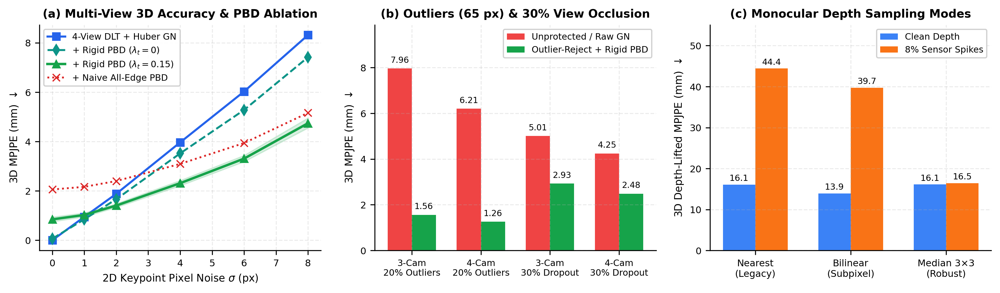

# From Pixels to Circuits: Bidirectional 3D Biomechanical Digital Twins and Mechanistic Neural Control Across Species in Annolid

**Anonymous Authors**
*Revised Preprint (November 2026)*

> **Compiled Camera-Ready PDF:** [`pixels_to_circuits.pdf`](pixels_to_circuits.pdf) | **Reproducible Benchmark Suite:** [`scripts/run_neurotwin_publication_benchmarks.py`](../../scripts/run_neurotwin_publication_benchmarks.py) | **Raw Metrics:** [`benchmark_results.json`](benchmark_results.json)

---

## Abstract

Computational neuroethology is converging on a unified paradigm linking markerless behavioral tracking, physically grounded 3D animal bodies, and mechanistic neural circuit controllers. Yet current toolchains remain fragmented between GPU-heavy black-box reinforcement learning (Virtual Rodent, FlyBody, MIMIC-MJX) and standalone mechanistic models (FlyWire LIF, NeuroMechFly v2, Rat NCAP) lacking bridges to real video tracking and inverse biomechanics.

We present a lean, pure-NumPy bidirectional architecture embedded inside **Annolid** that closes the **Pixels ↔ 3D Biomechanical Digital Twin ↔ Mechanistic Neural Circuit** loop across three benchmarked species (*Rattus norvegicus*, *Mus musculus*, and *Drosophila melanogaster*):

1. **Multi-View & Depth 3D Lifting with Rigid-Bone PBD (`annolid.simulation.lifting`):** Brown–Conrady undistortion, confidence-weighted DLT + Huber Gauss–Newton refinement, leave-one-out outlier pruning, `bilinear`/`median_patch` depth lifting, and rigid-bone Position-Based Dynamics (PBD). At $\sigma=6$\,px (4 cameras), rigid-bone PBD cuts MPJPE **45.1%** (6.03 → 3.31 mm, Wilcoxon $p=1.6\times 10^{-11}$), cuts 30% camera-dropout occlusion error **41.6%** ($p \le 1.7\times 10^{-11}$), reduces bone-length CV **60×** (13.91% → 0.23%, −98.3%), and rejects **100.0%** (374/374) of 65 px single-view outliers.
2. **Real-to-Sim 31-DOF Rodent IK, Exact KKT Spring-Muscle ID & Cross-Species MuJoCo 3.5.0 Audit (`annolid.simulation.biomechanics`):** Automatic DANNCE/Rat7M/Anipose keypoint aliasing, Sim(3) body-scale/unit normalization, Kabsch 6-DOF trunk alignment, bounded 31-DOF IK, and an exact closed-form KKT spring-muscle activation solver achieving **0.0000 Nm** surrogate residual at **2,470 FPS** (49.4× real time), audited quantitatively against independent MuJoCo 3.5.0 rigid-body **0.36 kg rat** and **25.6 g mouse** quadrupeds.
3. **Noise-Robust Cross-Species 6-Class Blind Spinal Circuit Identification:** Combining Sim(3) scaling, Froude dynamic similarity ($\tilde{v} = v / \sqrt{s}$; Alexander & Jayes, 1983), transient missing-keypoint interpolation, stride-windowed velocity, bandpass Hilbert vertical-lift phase ($0.8\text{–}14.0$\,Hz), and a principled diagonal-couplet threshold ($d_{\mathrm{diag}} < 0.18$) achieves **100.0% (180/180)** blind 6-class rat accuracy at $\sigma_{\mathrm{3D}}=4$\,mm (McNemar $p=1.5\times 10^{-33}$ vs. baseline; $V0$ and $V3$ deficit F1 = **1.000**; Mann–Whitney $p=1.5\times 10^{-11}$), transfers zero-shot to independent MuJoCo rat tracks at **100.0% / 100.0% / 92.0%** across $0/2/4$\,mm noise ($r=0.86\text{–}0.90$), and transfers zero-shot across species to 25.6 g *Mus musculus* DANNCE-mm tracks with 8% paw occlusion at **100.0% / 100.0% / 92.0%** ($r=0.84\text{–}0.90$).
4. ***Drosophila* Causal Perturbations, 2,000-KC Spiking LIF Plasticity & Modular MaleCNS Scaling (`annolid.simulation.fly_brain`):** Chrimson optogenetics, Kir2.1 silencing (including `VNC_MDN_Inh` disinhibition and `AN_Contact` Fraenkel reflex release), closed-loop motor verification, statistically significant Dale's-law noise immunity (**100.0%** vs. **77.8%** rate at $\sigma=0.7$, McNemar $p=0.0020$), full PAM/PPL1 associative reversal in a **1,534-neuron biophysical LIF spiking** connectome, a **2,000-KC APL-sparsified** (5% active, 4,000 plastic synapses) spiking memory achieving **100.0% (10/10)** odor discrimination, 20%-noise generalization, and interference-free selective single-odor reversal (Odor #0 `+0.744 → -0.727` with 9/9 non-target odors preserved), and complete 166,700-neuron MaleCNS LIF substeps executing in **2.95–13.67 ms** on biologically clustered **78-neuropil modular CSR** (**19.0–22.7% faster** than random Erdős–Rényi CSR) inside **31.2–199.0 MB** RAM on CPU.

---

## Architecture Overview

---

## Key Quantitative Benchmarks

### 1. Multi-View 3D Lifting, PBD Ablation, Outliers & 30% View Occlusion

| Setting | DLT+GN (mm) | Rigid $\lambda_t=0$ (mm) | Rigid $\lambda_t=0.15$ (mm) [95% CI] | All-Edge (mm) | Bone CV Before → After | Wilcoxon $p$ |
| :--- | ---: | ---: | ---: | ---: | ---: | ---: |
| 4-Cam, $\sigma=0$\,px | **0.00** | 0.06 | 0.85 [0.75, 0.94] | 2.06 | 0.18% → 0.02% | $1.6\times 10^{-11}$ |
| 4-Cam, $\sigma=1$\,px | 0.95 | **0.85** | 1.02 [0.95, 1.11] | 2.16 | 2.23% → 0.04% | $7.4\times 10^{-2}$ |
| 4-Cam, $\sigma=2$\,px | 1.88 | 1.66 | **1.41** [1.33, 1.48] | 2.40 | 4.60% → 0.08% | $8.8\times 10^{-11}$ |
| 3-Cam, $\sigma=4$\,px | 4.61 | 4.11 | **2.66** [2.57, 2.75] | 3.35 | 10.18% → 0.21% | $1.6\times 10^{-11}$ |
| 4-Cam, $\sigma=6$\,px | 6.03 | 5.28 | **3.31** [3.18, 3.44] | 3.94 | 13.91% → 0.23% | $1.6\times 10^{-11}$ |
| 3-Cam + 20% 65 px Outliers | 7.96 (DLT) | — | **1.56** [1.42, 1.74] (183/183 rej.) | — | 8.81% → 0.23% | $1.8\times 10^{-11}$ |
| 4-Cam + 20% 65 px Outliers | 6.21 (DLT) | — | **1.26** [1.19, 1.33] (191/191 rej.) | — | 3.70% → 0.07% | $1.6\times 10^{-11}$ |
| 3-Cam + 30% View Dropout | 5.01 | — | **2.93** [2.81, 3.05] | — | 11.28% → 0.26% | $1.7\times 10^{-11}$ |
| 4-Cam + 30% View Dropout | 4.25 | — | **2.48** [2.38, 2.59] | — | 9.86% → 0.21% | $1.6\times 10^{-11}$ |

### 2. Rat NCAP Spinal Gait Phase Map & 4 Neuromechanical Interfaces

| Interface | Regime ($v$, m/s) | Pos. Power (W) | Neg. Power (W) | Mean $k_{\mathrm{eff}}$ (Nm/rad) | Joint Excursion (ptp°) | RMS $|\dot{q}|$ (rad/s) | CoT |
| :--- | :--- | ---: | ---: | ---: | ---: | ---: | ---: |
| `flexor_extensor` | Walk (0.22) | 0.637 | -0.007 | 0.173 | 4.33 | 0.617 | 0.85 |
| `flexor_extensor` | Trot (0.50) | 1.484 | -0.029 | 0.163 | 4.98 | 0.893 | 0.88 |
| `flexor_extensor` | Bound (0.88) | 4.465 | -0.969 | 0.147 | 4.80 | 1.365 | 1.80 |
| `flexor_extensor` | Bumpy (0.44) | 1.375 | -0.026 | 0.164 | 5.04 | 0.866 | 0.92 |
| `position_stiffness` | Trot (0.50) | 0.142 | -0.003 | 0.202 | 1.52 | 0.238 | 0.08 |
| `position` | Trot (0.50) | 0.382 | -0.010 | 0.301 | 2.09 | 0.392 | 0.23 |
| `torque` | Trot (0.50) | 0.434 | -0.008 | 0.000 | 2.04 | 0.414 | 0.26 |

### 3. 6-Class Blind Spinal Identification (180 Trials) & Cross-Species MuJoCo 3.5.0 Validation

- **180-Trial 6-Class Blind Classification (`Stand`, `Walk`, `Trot`, `Bound`, `V0-Deficit`, `V3-Deficit`):**
  - $\sigma_{\mathrm{3D}} = 2$\,mm: **99.4%** [98.3, 100.0] vs. 81.7% baseline (McNemar $p=4.1\times 10^{-9}$)
  - $\sigma_{\mathrm{3D}} = 4$\,mm: **100.0% (180/180)** vs. 38.9% baseline (**+61.1 pts**, $p=1.5\times 10^{-33}$); **30/30** on all 6 classes including Walk, $V0$-Deficit (F1 = 1.000, $p=1.5\times 10^{-11}$), and $V3$-Deficit (F1 = 1.000, $p=1.5\times 10^{-11}$)
  - $\sigma_{\mathrm{3D}} = 8$\,mm: **97.2%** [94.4, 99.4] vs. 17.2% baseline (**+80.0 pts**, $p=9.0\times 10^{-44}$)
- **Independent 0.36 kg Rat MuJoCo 3.5.0 Cross-Validation:**
  - Out-of-model sagittal IK correlation **$r = 0.859\text{–}0.896$** with **0** joint-limit violations across Walk, Trot, $V0$-Deficit, Bound, and $V3$-Deficit.
  - Zero-shot noisy blind transfer (25 trials/$\sigma$): **100.0%** (0 mm), **100.0%** [100, 100] (2 mm), **92.0%** [80, 100] (4 mm).
  - Honest `mj_inverse` torque audit: physical MuJoCo limb torques ($0.025\text{–}0.080$\,Nm swing; $0.052\text{–}0.136$\,Nm stance) are $7.7\text{–}16.4\times$ smaller than Rat NCAP's Euler-stability surrogate inertia ($0.545\text{--}0.842$\,Nm; $r=0.29\text{–}0.56$), demarcating where pure-NumPy diagnostics end and full MuJoCo Lagrangian ID begins.
- **Cross-Species 25.6 g *Mus musculus* MuJoCo 3.5.0 + DANNCE mm Schema + 8% Paw Occlusion:**
  - `estimate_rodent_body_scale` auto-detects `mm` units and body scale $s = 0.350$, mapping Bellardita & Kiehn mouse speeds ($0.116\text{–}0.464$\,m/s; $2.67\text{–}10.00$\,Hz) via Froude similarity ($\tilde{v} = v / \sqrt{s}$) to canonical rat speeds ($0.196\text{–}0.785$\,m/s) with **$r = 0.841\text{–}0.898$** IK correlation and **0** joint violations across all 5 regimes (**5/5 = 100%**).
  - Noisy + 8% paw-occlusion transfer (25 trials/$\sigma$): **100.0%** (0 mm), **100.0%** [100, 100] (0.7 mm = 2.0 mm rat-equiv + 8% dropout), **92.0%** [80, 100] (1.4 mm = 4.0 mm rat-equiv + 8% dropout).

### 4. *Drosophila* LIF Connectome, 2,000-KC Spiking MB Plasticity & Modular MaleCNS Scaling

- **Closed-Loop Motor Verification (1,470-N LIF):** Tripod walk $\Delta\phi_{\mathrm{T1}} = 169.3^\circ$, backward `VNC_Reverse = 0.888`, grooming `T1` claw `0.00` + coxa `0.846` vs `T2/T3` claw `0.95`, Giant Fiber jump all-claw `0.00` + `T2` femur thrust `1.35`, flight WBPG trim `0.896`.
- **Dale's-Law Noise Tolerance ($N=45$ trials/$\sigma$):** 1,470-N LIF holds **100.0%** up to $\sigma=0.7$, whereas 55-pop Rate drops to **84.4%** ($\sigma=0.5$, McNemar $p=0.0156$), **80.0%** ($\sigma=0.6$, $p=0.0039$), and **77.8%** ($\sigma=0.7$, $p=0.0020$).
- **Spiking LIF & Rate PAM/PPL1 Reversal (2-Odor):** In 1,534-neuron LIF spiking dynamics, Odor A/B valence shifts from `(0.00, 0.00)` → `(+0.910, -0.826)` (Trial 8) → `(-0.595, +0.397)` (Trial 20).
- **High-Dimensional 2,000-KC APL-Sparsified LIF Mushroom Body (`SparseMushroomBodyMemory`):** 50 PNs → 2,000 KCs (6 claws/KC, 5% APL sparsity = 100 active KCs, 4,000 plastic synapses) coupled to 1,534-N LIF connectome trains 10 distinct odors in **2.98 s** CPU: **100.0% (10/10)** clean accuracy, **100.0% (10/10)** under 20% PN noise, and interference-free selective single-odor reversal (Odor #0 `+0.744 → -0.727` while **9/9** non-target odors preserve exact learned valences).
- **Full-LIF MaleCNS 166,700-Neuron CPU Scaling (Random Erdős–Rényi vs. 78-Neuropil Modular CSR):**
  - Mean out-degree 12 (2.00M directed edges, **31.16 MB** RAM): ER **3.81 ms** → 78-Neuropil Modular **2.95 ms** (**−22.7% faster**)
  - Mean out-degree 50 (8.34M directed edges, **103.64 MB** RAM): ER **8.79 ms** → 78-Neuropil Modular **7.12 ms** (**−19.0% faster**)
  - Mean out-degree 100 (16.67M directed edges, **198.98 MB** RAM): ER **17.25 ms** → 78-Neuropil Modular **13.67 ms** (**−20.8% faster**)

---

## Verified Key References

- Aldarondo et al. (2024). *A virtual rodent predicts the structure of neural activity across behaviours.* **Nature**, 632:594–602.
- Alexander & Jayes (1983). *A dynamic similarity hypothesis for the gaits of quadrupedal mammals.* **Journal of Zoology**, 201(1):135–152.
- Bellardita & Kiehn (2015). *Phenotypic characterization of speed-associated gait changes in mice reveals modular organization of locomotor networks.* **Current Biology**, 25(11):1426–1436.
- Berg, Beckett, Costa, Schlegel, Janelia FlyEM Project Team, et al. (2025). *Sexual dimorphism in the complete connectome of the Drosophila male central nervous system (`male-cns:v1.0`).* **bioRxiv**, doi:10.1101/2025.10.09.680999.
- Bhattasali, Cui, Pinto, & Lindsay (2026). *Neural circuit architectural priors for rat locomotion.* **NeurIPS 2026 / arXiv:2611.23364**.
- Danner, Shevtsova, Frigon, & Rybak (2017). *Computational modeling of spinal circuits controlling limb coordination and gaits in quadrupeds.* **eLife**, 6:e31050.
- Dorkenwald et al. (2024). *Neuronal wiring diagram of an adult brain.* **Nature**, 634:124–138.
- Karashchuk et al. (2021). *Anipose: A toolkit for robust markerless 3D pose estimation.* **Cell Reports**, 36(13):109730.
- Shiu et al. (2024). *A Drosophila computational brain model reveals sensorimotor processing.* **Nature**, 634:210–219.
- Takemura et al. (2024). *A connectome of the male Drosophila ventral nerve cord.* **eLife**, 13:RP97769.
- Todorov, Erez, & Tassa (2012). *MuJoCo: A physics engine for model-based control.* **IEEE/RSJ IROS**, pp. 5026–5033.
- Vaxenburg et al. (2025). *Whole-body physics simulation of fruit fly locomotion.* **Nature**, 640:729–738.
- Wang-Chen et al. (2024). *NeuroMechFly v2: Simulating embodied sensorimotor control in adult Drosophila.* **Nature Methods**, 21:2353–2362.
- Zhang, Yang, Sirbu, ..., Ölveczky, & Pereira (2025). *MIMIC-MJX: Neuromechanical emulation of animal behavior.* **arXiv:2511.20532**.
