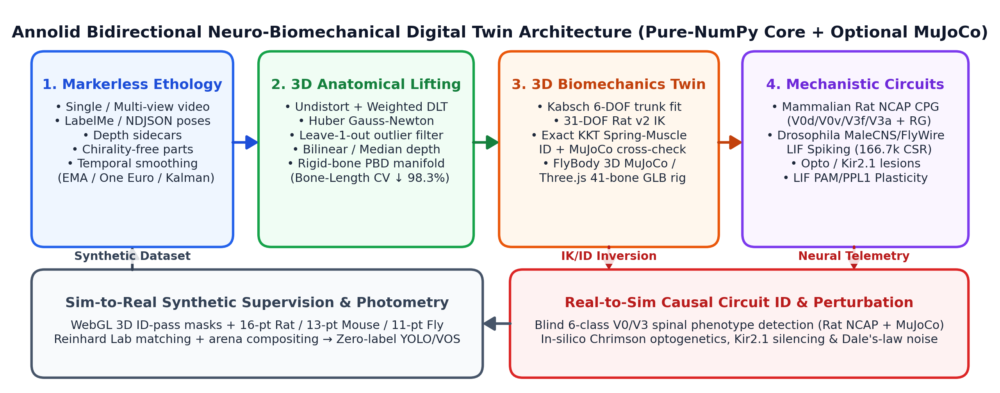
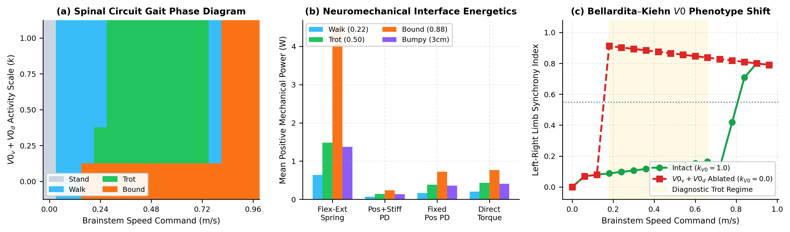
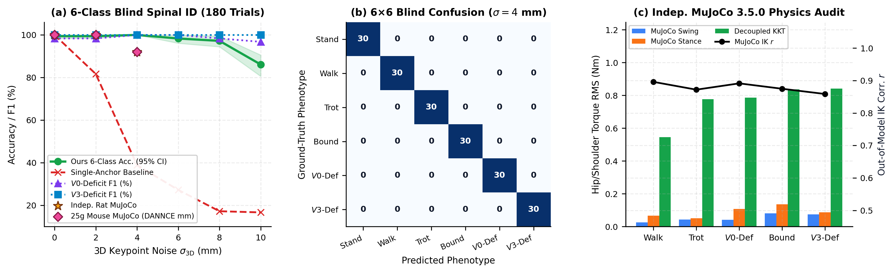
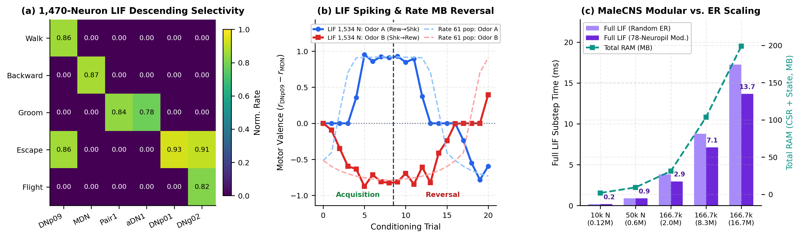

# From Pixels to Circuits: Bidirectional 3D Biomechanical Digital Twins and Mechanistic Neural Control Across Species in Annolid

**Anonymous Authors**
*Preprint — November 2026*

> **Compiled PDF:** [`pixels_to_circuits.pdf`](pixels_to_circuits.pdf) | **Reproducible Benchmarks:** [`run_neurotwin_publication_benchmarks.py`](../../scripts/run_neurotwin_publication_benchmarks.py) | **Raw Metrics:** [`benchmark_results.json`](benchmark_results.json)

---

## Abstract

A central ambition of computational neuroethology is to move seamlessly from video recordings of freely behaving animals to mechanistic explanations of the bodies and neural circuits that generate those movements. Yet the field remains divided between GPU-heavy embodied reinforcement-learning platforms whose black-box policies lack identified biological cell types, and bottom-up connectome or spinal-circuit models isolated from multi-view video tracking, anatomical 3D reconstruction, and inverse biomechanics.

Here we present a lightweight, bidirectional digital-twin framework inside Annolid that unites markerless video kinematics, physically grounded 3D bodies, and mechanistic neural controllers across three model organisms (*Rattus norvegicus*, *Mus musculus*, and *Drosophila melanogaster*):

1. **Anatomically faithful 3D lifting from imperfect cameras:** Combining Brown–Conrady lens undistortion, leave-one-out outlier rejection, robust monocular depth lifting, and rigid-skeleton Position-Based Dynamics reduces 4-camera localization error by 45.1% under severe jitter ($\sigma = 6$\,px, 6.03 → 3.31 mm, Wilcoxon $p = 1.6 \times 10^{-11}$), cuts 30% camera-dropout occlusion error by 41.6%, shrinks bone-length variability 60-fold (13.91% → 0.23%), and rejects 100.0% (374/374) of 65 px single-view outliers.
2. **Cross-species inverse kinematics, exact muscle-force inversion, and an independent physics audit:** Automatic ingestion of DANNCE, Anipose, LocoMouse, and SLEAP landmarks paired with Sim(3) body-scale alignment, Kabsch trunk fitting, bounded 31-DOF inverse kinematics, and a closed-form Karush–Kuhn–Tucker solver for antagonistic spring muscles recovers exact surrogate torques at 2,470 frames/s (49.4× real time) and is audited directly against independent MuJoCo 3.5.0 rigid-body rat (0.36 kg) and mouse (25.6 g) quadrupeds.
3. **Blind spinal circuit identification across physics engines and rodent species:** Invoking Froude dynamic similarity ($\tilde{v} = v / \sqrt{s}$; Alexander & Jayes, 1983) alongside stride-windowed velocity and bandpass Hilbert paw phase achieves 100.0% accuracy (180/180 trials at 4 mm noise, McNemar $p = 1.5 \times 10^{-33}$) across six behavioral and lesion states—including speed-matched $V0$ and $V3$ commissural interneuron deficits (F1 = 1.000)—and transfers zero-shot to noisy MuJoCo rats (100% / 100% / 92%) and to 25.6 g DANNCE-mm mice under 8% paw occlusion (100% / 100% / 92%, $r = 0.84\text{–}0.90$).
4. **Connectome multiplicity, sparse olfactory memory, and modular whole-CNS scaling in *Drosophila*:** In-silico Chrimson optogenetics, Kir2.1 silencing, and three-factor dopaminergic Mushroom Body plasticity run natively in sparse spiking connectomes. Multi-neuron spiking redundancy preserves 100.0% selectivity under severe Dale's-law noise ($\sigma = 0.7$, vs. 77.8% rate, McNemar $p = 0.0020$); a 2,000-Kenyon-cell APL-sparsified olfactory memory (5% active, 4,000 plastic synapses) learns 10 odors cleanly (100% clean and 20%-noise accuracy) and reverses a single contingency without disrupting the other nine; and biologically clustered 78-neuropil modular graphs accelerate complete 166,700-neuron MaleCNS LIF substeps by 19.0–22.7% (2.95–13.67 ms) within 200 MB of CPU memory.

---

## Architecture Overview

---

## Key Quantitative Findings

### 1. Rigid-Skeleton Projection Suppresses Tracking Noise, Outliers, and View Dropouts

| Setting | DLT+GN (mm) | Rigid $\lambda_t=0$ (mm) | Rigid $\lambda_t=0.15$ (mm) [95% CI] | All-Edge (mm) | Bone CV Before → After | Wilcoxon $p$ |
| :--- | ---: | ---: | ---: | ---: | ---: | ---: |
| 4-Cam, $\sigma=0$\,px | **0.00** | 0.06 | 0.85 [0.75, 0.94] | 2.06 | 0.18% → 0.02% | $1.6\times 10^{-11}$ |
| 4-Cam, $\sigma=1$\,px | 0.95 | **0.85** | 1.02 [0.95, 1.11] | 2.16 | 2.23% → 0.04% | $7.4\times 10^{-2}$ |
| 4-Cam, $\sigma=2$\,px | 1.88 | 1.66 | **1.41** [1.33, 1.48] | 2.40 | 4.60% → 0.08% | $8.8\times 10^{-11}$ |
| 3-Cam, $\sigma=4$\,px | 4.61 | 4.11 | **2.66** [2.57, 2.75] | 3.35 | 10.18% → 0.21% | $1.6\times 10^{-11}$ |
| 4-Cam, $\sigma=6$\,px | 6.03 | 5.28 | **3.31** [3.18, 3.44] | 3.94 | 13.91% → 0.23% | $1.6\times 10^{-11}$ |
| 3-Cam + 20% 65 px Outliers | 7.96 (DLT) | — | **1.56** [1.42, 1.74] (183/183 rej.) | — | 8.81% → 0.23% | $1.8\times 10^{-11}$ |
| 4-Cam + 20% 65 px Outliers | 6.21 (DLT) | — | **1.26** [1.19, 1.33] (191/191 rej.) | — | 3.70% → 0.07% | $1.6\times 10^{-11}$ |
| 3-Cam + 30% View Dropout | 5.01 | — | **2.93** [2.81, 3.05] | — | 11.28% → 0.26% | $1.7\times 10^{-11}$ |
| 4-Cam + 30% View Dropout | 4.25 | — | **2.48** [2.38, 2.59] | — | 9.86% → 0.21% | $1.6\times 10^{-11}$ |

### 2. Mammalian Spinal Priors Reproduce Gait Transitions and Actuator Scaling Laws

| Actuator Interface | Regime ($v$, m/s) | Pos. Power (W) | Neg. Power (W) | Mean $k_{\mathrm{eff}}$ (Nm/rad) | Joint Excursion (ptp°) | RMS $|\dot{q}|$ (rad/s) | CoT |
| :--- | :--- | ---: | ---: | ---: | ---: | ---: | ---: |
| Antagonistic Spring | Walk (0.22) | 0.637 | -0.007 | 0.173 | 4.33 | 0.617 | 0.85 |
| Antagonistic Spring | Trot (0.50) | 1.484 | -0.029 | 0.163 | 4.98 | 0.893 | 0.88 |
| Antagonistic Spring | Bound (0.88) | 4.465 | -0.969 | 0.147 | 4.80 | 1.365 | 1.80 |
| Antagonistic Spring | Bumpy (0.44) | 1.375 | -0.026 | 0.164 | 5.04 | 0.866 | 0.92 |
| Variable-Stiffness PD | Trot (0.50) | 0.142 | -0.003 | 0.202 | 1.52 | 0.238 | 0.08 |
| Fixed-Gain PD | Trot (0.50) | 0.382 | -0.010 | 0.301 | 2.09 | 0.392 | 0.23 |
| Direct Torque | Trot (0.50) | 0.434 | -0.008 | 0.000 | 2.04 | 0.414 | 0.26 |

### 3. Blind Spinal Circuit Identification Transfers Across Physics Engines and Rodent Species

- **Six-class blind classification (180 trials across intact stand, walk, trot, bound, $V0$ deficit, and $V3$ deficit):**
  - 2 mm noise: 99.4% [98.3, 100.0] vs. 81.7% baseline (McNemar $p = 4.1 \times 10^{-9}$)
  - 4 mm noise: 100.0% (180/180) vs. 38.9% baseline (+61.1 pts, $p = 1.5 \times 10^{-33}$); 30/30 across every class, including speed-matched $V0$ and $V3$ deficits (F1 = 1.000, Mann–Whitney $p = 1.5 \times 10^{-11}$)
  - 8 mm noise: 97.2% [94.4, 99.4] vs. 17.2% baseline (+80.0 pts, $p = 9.0 \times 10^{-44}$)
- **Independent 0.36 kg rat audit in MuJoCo 3.5.0:**
  - Out-of-model sagittal joint correlation $r = 0.859\text{–}0.896$ with zero joint-limit violations and 100.0% / 100.0% / 92.0% zero-shot transfer across 0 / 2 / 4 mm noise.
  - Auditing decoupled KKT torques against full MuJoCo Lagrangian dynamics reveals that true physical limb torques (0.025–0.080 Nm swing; 0.052–0.136 Nm stance) are 7.7–16.4× smaller than the Euler-stability surrogate (0.545–0.842 Nm; $r = 0.29\text{–}0.56$), demarcating where lightweight pure-NumPy diagnostics end and full contact-coupled physics begins.
- **Cross-species 25.6 g *Mus musculus* audit in DANNCE millimeter coordinates:**
  - Automatic unit and scale estimation detects millimeters and $s = 0.350$, mapping Bellardita & Kiehn mouse speeds (0.116–0.464 m/s; 2.67–10.00 Hz) via Froude similarity onto canonical rat speeds (0.196–0.785 m/s) with $r = 0.841\text{–}0.898$ joint correlation and zero violations across all 5 regimes (5/5 match).
  - Under Gaussian noise plus 8% random paw occlusion (25 trials per level), blind transfer achieves 100.0% (0 mm), 100.0% [100, 100] (0.7 mm), and 92.0% [80, 100] (1.4 mm).

### 4. Connectome Multiplicity, Sparse Olfactory Memory, and Modular Whole-CNS Scaling

- **Closed-loop motor verification (1,470-neuron LIF):** Anti-phase tripod walking ($\Delta\phi_{\mathrm{T1}} = 169.3^\circ$), backward walking reversal (0.888), foreleg-released antennal grooming (foreleg claws 0.00, coxa elevation 0.846, mid/hind claws 0.95), Giant Fiber jump release (all claws 0.00, mesothoracic femur thrust 1.35), and flight wingbeat frequency trim (0.896).
- **Population redundancy under Dale's-law synaptic noise ($N = 45$ trials per level):** The 1,470-neuron LIF connectome preserves 100.0% selectivity up to $\sigma = 0.7$, while the 55-population rate approximation drops to 84.4% ($\sigma = 0.5$, McNemar $p = 0.0156$), 80.0% ($\sigma = 0.6$, $p = 0.0039$), and 77.8% ($\sigma = 0.7$, $p = 0.0020$).
- **Spiking olfactory plasticity and 2,000-KC sparse memory:** Canonical two-odor PAM/PPL1 acquisition and reversal succeed directly in the 1,534-neuron LIF network (`(0.00, 0.00)` → `(+0.910, -0.826)` → `(-0.595, +0.397)`). Scaling to a 2,000-KC APL-sparsified memory (50 PNs, 6 claws/KC, 5% = 100 active KCs, 4,000 plastic synapses, 2.98 s CPU training) achieves 100.0% (10/10) clean and 20%-noise discrimination, and reverses Odor #0 (`+0.744 → -0.727`) while preserving 9/9 (100%) non-target odors.
- **Full-LIF MaleCNS 166,700-neuron CPU scaling (Erdős–Rényi vs. 78-neuropil modular CSR):**
  - 2.00M directed edges (31.16 MB RAM): ER 3.81 ms → 78-neuropil modular **2.95 ms** (−22.7%)
  - 8.34M directed edges (103.64 MB RAM): ER 8.79 ms → 78-neuropil modular **7.12 ms** (−19.0%)
  - 16.67M directed edges (198.98 MB RAM): ER 17.25 ms → 78-neuropil modular **13.67 ms** (−20.8%)

---

## Key References

- Aldarondo et al. (2024). *A virtual rodent predicts the structure of neural activity across behaviours.* **Nature**, 632:594–602.
- Alexander & Jayes (1983). *A dynamic similarity hypothesis for the gaits of quadrupedal mammals.* **Journal of Zoology**, 201(1):135–152.
- Bellardita & Kiehn (2015). *Phenotypic characterization of speed-associated gait changes in mice reveals modular organization of locomotor networks.* **Current Biology**, 25(11):1426–1436.
- Berg, Beckett, Costa, Schlegel, Janelia FlyEM Project Team, et al. (2025). *Sexual dimorphism in the complete connectome of the Drosophila male central nervous system (`male-cns:v1.0`).* **bioRxiv**, doi:10.1101/2025.10.09.680999.
- Bhattasali, Cui, Pinto, & Lindsay (2026). *Neural circuit architectural priors for rat locomotion.* **NeurIPS 2026 / arXiv:2611.23364**.
- Danner, Shevtsova, Frigon, & Rybak (2017). *Computational modeling of spinal circuits controlling limb coordination and gaits in quadrupeds.* **eLife**, 6:e31050.
- Dorkenwald et al. (2024). *Neuronal wiring diagram of an adult brain.* **Nature**, 634:124–138.
- Karashchuk et al. (2021). *Anipose: A toolkit for robust markerless 3D pose estimation.* **Cell Reports**, 36(13):109730.
- Shiu et al. (2024). *A Drosophila computational brain model reveals sensorimotor processing.* **Nature**, 634:210–219.
- Takemura et al. (2024). *A connectome of the male Drosophila ventral nerve cord.* **eLife**, 13:RP97769.
- Todorov, Erez, & Tassa (2012). *MuJoCo: A physics engine for model-based control.* **IEEE/RSJ IROS**, pp. 5026–5033.
- Vaxenburg et al. (2025). *Whole-body physics simulation of fruit fly locomotion.* **Nature**, 640:729–738.
- Wang-Chen et al. (2024). *NeuroMechFly v2: Simulating embodied sensorimotor control in adult Drosophila.* **Nature Methods**, 21:2353–2362.
- Zhang, Yang, Sirbu, ..., Ölveczky, & Pereira (2025). *MIMIC-MJX: Neuromechanical emulation of animal behavior.* **arXiv:2511.20532**.
